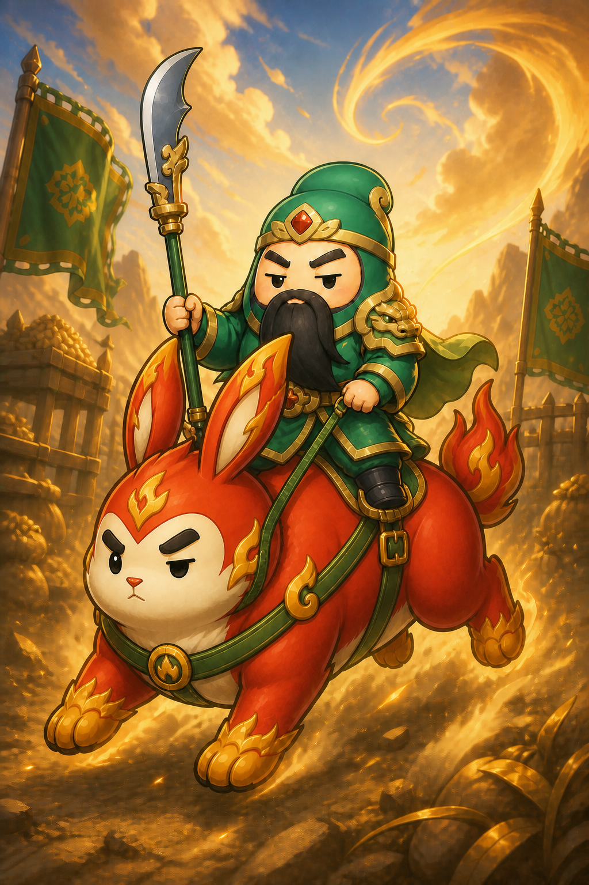
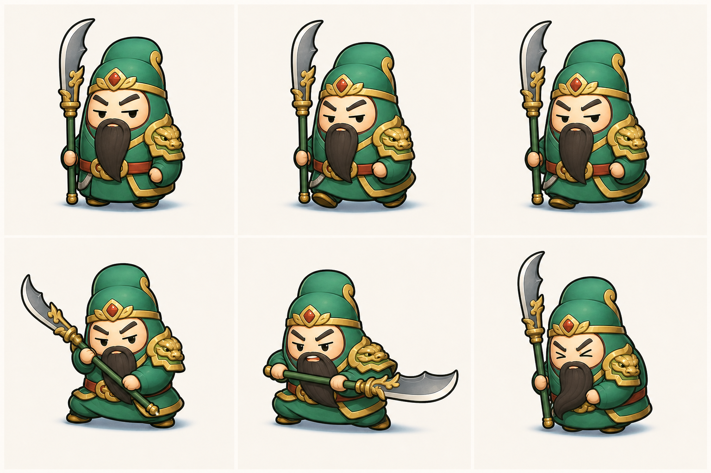

# shuraid-archive — 一个游戏项目的四次尝试

2026-08-07 到 08-12，同一个想法被做了四遍，全部没有跑通。这个仓库把四次尝试原样冻在一起，供事后研究。

不是作品集，是现场。

## 为什么公开

不删、不美颜、不重写。四次尝试的目录、提交、素材，连停手时还没提交的工作区改动，都原样冻在这里。

公开有两个用处：一是我自己回头看，二是给别人当筛子——下次起项目前拿它过一遍，能过再动手（标准在 `POSTMORTEM.md` 最后一节）。

**先说清楚下面这两张图是什么。** 左边是这个项目最好看的部分，右边是它真正死掉的地方。概念图和能落进引擎的动作帧之间有一段落差，5 天 39 次提交都在补这段，没补上。

<table>
  <tr>
    <td width="50%"><br><sub>概念图 · <code>v4-legs-fixed</code>（文件名本身记着改了几版）</sub></td>
    <td width="50%"><br><sub>动作研究 · 6 帧。真正要接进引擎的是这一张，不是左边那张</sub></td>
  </tr>
</table>

## 四次尝试

| # | 目录 | 时间 | 提交 | 游戏代码 | 停手状态 |
|---|---|---|---|---|---|
| 01 | `iterations/01-luanshi-survivor/` | 08-07 建 → 08-10 15:13 冻结 | 5 | 6,672 行 / 33 文件 | 冻结，主动放弃 |
| 02 | `iterations/02-shuraid-cocos/` | 08-10 15:19 → 22:07 | 6 | 1,400 行 / 11 文件 | 当晚建新版，弃 |
| 03 | `iterations/03-shuraid2d/` | 08-11 02:39 → 23:56 | 17 | 591 行 / 5 文件 | 次日凌晨停手，弃 |
| 04 | `iterations/04-danke/` | 08-11 16:29，单提交 | 1 | 1,236 行 / 4 文件 | 提交后 55 分钟停手 |

01 是原生 JS + Canvas 的微信小游戏原型（28 个 js、5,137 行），02 起换成 Cocos Creator 3.8.8 + 微信小游戏目标。

严格说是五次。`01-luanshi-survivor/` 里除了原生原型，还藏着一个 `cocos-client/`：38 个文件，带 `BattleSlice.scene`、`guan-atlas.png` 和一份 `guan-slice.json`。**Cocos 这条路在 08-07 第一天就起过一次头，没走通。** 它不构成一次独立的尝试，但它是后面四次反复停在同一个死点最早的那份证据。

## 阅读路径

1. **`TIMELINE.md`** — 从文件系统和 git 元数据还原的逐小时记录。两次重建的间隔都是 **35 秒**，中间没有思考时间。
2. **`POSTMORTEM.md`** — 为什么四次都没成，以及为什么第四次看起来"成了"其实也没成。
3. **`iterations/`** — 四份完整快照，各自保留原始提交历史。

## 历史怎么查

四个版本用 subtree merge 并入，原始提交 sha 都在。路径过滤看不到旧提交（它们的路径没有 `iterations/` 前缀），从各版本**最后一个提交**往回查：

```bash
git log 4a3652e     # 01 的完整历史（5 个提交）
git log c36173b     # 02（6 个）
git log d623dc8     # 03（17 个）
git log cf80c17     # 04（1 个）
git show <sha>      # 单次改动的完整 diff
```

纯文本导出在 `_meta/commit-logs/`。

`_meta/uncommitted-changes.txt` 记录了 02 和 03 停手时工作区里还没提交的改动 —— 那些内容只在源仓库的工作区存在过，一次误删就没了，这里做了固化。

## 素材

`iterations/` 里共 194 个图片/音频文件，133.1 MB。01 和 02 之间有 60 组内容完全相同的重复文件（31.5 MB），没有去重 —— 保留每份快照的完整性比省这点空间重要。

概念图集中在 `01-luanshi-survivor/assets/concepts/` 和 `02-shuraid-cocos/art-source/`，单张 1.3–2.7 MB，文件名带 `candidate` / `v1` / `v4-legs-fixed` 这类后缀，记录了当时的取舍过程。

## 一句话结论

失败不在技术，在协作方式：把 AI 当需要逐步下令的士兵，自己就必须是能下到每个细节的指挥官。而这个项目的领域（游戏手感）恰好是最难用语言下指令的地方，于是每一轮都走到同一个死点 —— 手感调不动 → 推翻重来 → 35 秒后开新目录。
